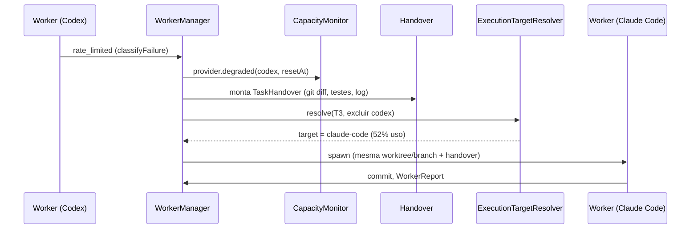

# APO em ação — exemplos de uso (sistema finalizado)

Este documento não é especificação — é ilustração. Mostra, em transcrições de terminal, como o APO se comporta depois de pronto (M0–M6), cobrindo os caminhos descritos em `PLAN.md`, `ROADMAP.md` e `TECHNICAL_PLAN.md`. Cada exemplo aponta para a seção correspondente.

---

## 1. Pergunta rápida — sem criar Feature

`IntentTriage` (ROADMAP §4.3) responde direto, sem Feature/Task/worktree.

```text
$ apo run "o que faz o ProductCard hoje?"

[IntentTriage] "question" detectado — sem criar Feature/Task.

Lead > O ProductCard (src/components/ProductCard.tsx) renderiza nome,
       preço e imagem de um produto. Não busca dados — recebe via props.
       Usado em ProductGrid e em dois testes de snapshot.

(resposta em 4s — evento `query.answered` registrado, nenhuma Feature criada)
```

---

## 2. Bugfix simples — uma Task, ciclo completo

```text
$ apo run "o filtro de categoria na página de produtos não limpa ao trocar de aba"

[IntentTriage] "bugfix" detectado.
Lead > Feature F-118 criada. Workflow: Bugfix (REPRODUCE → DIAGNOSE → FIX → TEST → REVIEW)
Lead > 1 Task: T-118-1 "corrigir reset do filtro de categoria ao trocar de aba"
Router > role: frontend-developer → preferred: Claude Code (41% uso) → disponível

[T-118-1] worktree isolada ~/.apo/worktrees/orbit-jobs/f118/t1
[T-118-1] Claude Code working...
[T-118-1] ✓ commit: fix: reset category filter on tab change

Quality gates: build ✓ lint ✓ typecheck ✓ tests ✓
Reviewer (Codex): nenhum problema encontrado

APO > Feature pronta. Deseja abrir o Pull Request? [s/N]
> s
APO > PR #342 aberto: "fix: category filter not resetting on tab change"
```

---

## 3. O cenário central — DAG, paralelismo, failover e review loop

Este é o critério de sucesso da V1 (`PLAN.md` §38). A Task `T3` perde o Codex no meio e é retomada pelo Claude Code, sem intervenção humana.

```text
$ apo run "crie uma página para apresentar os produtos da empresa"

Lead > Feature F-129 criada: "Página de produtos"
Lead > 5 Tasks identificadas:
  T1 [qa-engineer]        reconhecer estrutura atual de catálogo
  T2 [frontend-developer] criar ProductCard                 (depende de T1)
  T3 [backend-developer]  criar endpoint GET /api/products   (depende de T1)
  T4 [frontend-developer] criar ProductsPage                (depende de T2, T3)
  T5 [qa-engineer]        testes de integração               (depende de T4)
```

```text
T1 (qa)        ─┬─→ T2 (frontend) ─┐
 estrutura        │                  ├─→ T4 (frontend) ─→ T5 (qa)
 do catálogo      └─→ T3 (backend) ──┘    ProductsPage    testes
```

```text
[T1] shared (read-only) — concluída em 12s
[T2] worktree isolada f129/t2 — Claude Code working...
[T3] worktree isolada f129/t3 — Codex working...

[T3] ⚠ rate_limited (Codex atingiu quota)
     → handover gerado (diff + testes + próximos passos)
     → T3 retomada por Claude Code (52% uso), mesma worktree/branch

[T2] ✓ commit: feat: add ProductCard component
[T3] ✓ commit: feat: add GET /api/products endpoint (retomado por Claude Code)

[T4] worktree isolada f129/t4 — lê o artefato: contrato de /api/products de T3
[T4] ✓ commit: feat: add ProductsPage

[T5] shared sobre a integração — 8 testes novos, todos passando

Quality gates: build ✓ lint ✓ typecheck ✓ tests ✓
Reviewer (Gemini): 2 problemas
  - [medium] ProductsPage não trata estado de erro da API
  - [low] ProductCard sem alt text na imagem

Lead > Criando Tasks corretivas T6, T7...
[T6] ✓ fix: handle API error state in ProductsPage
[T7] ✓ fix: add alt text to ProductCard image

Quality gates (2ª rodada): ✓ ✓ ✓ ✓  |  Reviewer: nenhum problema

APO > Feature pronta. Deseja abrir o Pull Request? [s/N]
> s
APO > PR #343 aberto: "feat: products page"
```

O momento do failover de `T3`, em detalhe (`TECHNICAL_PLAN.md` §6.4, §6.5):



---

## 4. Duas Features colidindo — `FeatureOverlapCheck`

Nunca absorve automaticamente (ROADMAP §4.4) — sempre pergunta.

```text
$ apo run "adicione favoritos aos produtos"

[FeatureOverlapCheck] expectedPaths do objetivo novo cruzam com
                       src/api/products.ts — Feature F-129 ainda executing

APO > Essa solicitação parece relacionada à Feature F-129 (em andamento).
        [1] Isolar   — Feature nova e independente
        [2] Absorver — Tasks novas na F-129 (mesma branch)
> 2

Lead > Absorvido em F-129. Tasks T8, T9 criadas.
       (evento feature.request_absorbed registrado)
```

---

## 5. Comunicação entre agentes (ROADMAP §4.2)

**(a) Mailbox assíncrona** — nunca bloqueia quem envia:

```text
[T4, frontend-developer] envia information → to: backend-developer
  "Vou paginar por cursor, não por offset — avisem se o endpoint mudar"
[T4] segue trabalhando sem esperar resposta

… mais tarde, numa Task de backend futura …
[T12, backend-developer] prompt inclui, via AgentInbox:
  "[de T4/frontend-developer] Vou paginar por cursor, não por offset..."
```

**(b) Pergunta bloqueante a um agente persistente** — só isso pode pausar a Task:

```text
[T9, qa-engineer] blockedQuestion → to: product-owner
  "Favoritos devem persistir entre sessões deslogadas?"

Task T9 → awaiting_answer
AgentRunner("product-owner") responde usando os requirements da Feature:
  "Não — favoritos exigem usuário autenticado (requirement R3)."

[T9] resume com a resposta no contexto (resume(sessionId) nativo)
```

---

## 6. `apo chat` — Lead conversacional com replan

```text
$ apo chat
APO  > Crie uma página para mostrar os produtos.
Lead > Analisei o projeto e criei a Feature F-129. 5 Tasks identificadas...

APO  > Não altere o backend, já temos um endpoint pronto em outra branch.
Lead > Entendido. Removendo T3; T4 passa a depender do artefato existente.
       Plano atualizado.

APO  > status
Lead > F-129: executing — T1 ✓, T2 Claude Code working, T4 pending
```

---

## 7. Observabilidade do dia a dia

```text
$ apo providers
PROVIDER   STATUS       USAGE     ACTIVE WORKERS
Claude     available    52%       2
Codex      degraded     92%       0   (resetAt: 14:32)
Gemini     available    unknown   1

$ apo role list
ROLE                 SOURCE      SYSTEM PROMPT (resumo)
frontend-developer   project     "...componentes React reutilizáveis, usa a skill..."
backend-developer    built-in    "...APIs REST, validação com zod..."
qa-engineer           built-in    "...escreve testes, não decide escopo..."
cto                   project     "...julgamento arquitetural, consultivo..."
```
